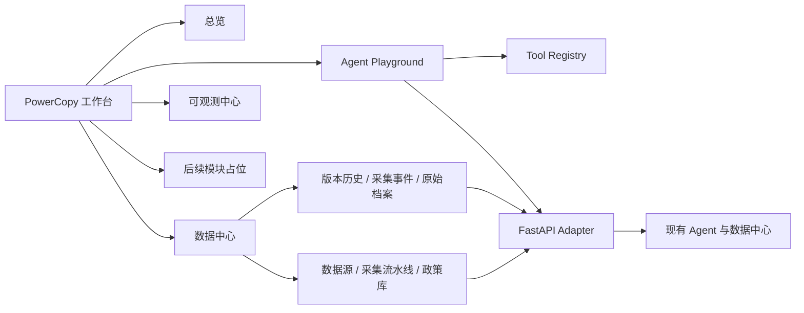

# PowerCopy V2 工作台

## 项目现状与接入范围

工作台与完整 V2 工程合并为同一仓库。`workbench/` 为后端 API，`frontend/` 为前端，共用根目录的 `powercopy/` 数据层。`POWERCOPY_PROJECT_ROOT` 默认指向仓库根目录，无需额外配置。

在库政策取自完整工程的 `storage/policies_versioned.db`。核对时有 2 条政策、2 个已存版本、2 条采集事件，均为 v1。两条政策地区均未标注。注册表包含 3 个数据源，归档含 3 份离线采集报告、15 条待审核候选、4 份官方 HTML 原档和 1 份合成 PDF 验收样本。

| 界面 | 现有能力 | 工作台适配 |
| --- | --- | --- |
| 总览 | SourceRegistry、版本库、采集报告、验收脚本 | 查询实际计数、归档运行和本地验收结果 |
| 数据源 | `build_source_registry`、`DataSource`、`FetchTarget` | 展示白名单、目标与已有运行发现的候选 |
| 采集流水线 | `IngestionPipeline`、`HttpFetcher`、原始 JSON、HTML Parser、`PolicyDocument`、`VersionedPolicyStore` | 展示已有产物，从档案 ID 离线重放，临时 SQLite 隔离写入 |
| 政策库与版本 | `PolicyQueryService`、SQLite `policy_identities`、`policy_versions`、`policy_documents` | 通过现有查询服务读正文，使用只读查询展示列表、版本时间线、哈希及差异 |
| 采集事件与原始档案 | `policy_fetches`、HTML 原始 JSON、`PdfArtifact` | 固定 ID 查询、受限文本预览、关联原始记录 |
| Agent Playground | `Agent`、`MessageManager`、`LLMClient`、`TaskBudget` | 离线 Mock LLM 驱动真实 Agent Loop，工具读取指定 SQLite |
| Tool Registry | `ToolRegistry`、`ToolExecutor`、`build_live_registry` | 显示真实注册的 `search_policy`、`get_policy_detail` 及参数 Schema |
| 可观测中心 | `ExecutionTrace`、模型与工具事件、失败重试 | 展示本次浏览器会话的实际任务，附原生 Trace 与工具交互结果 |



## API 契约

业务接口统一使用 `/api/workbench`，JSON 成功体为 `{"data": ...}`，错误体为 `{"error": {"code": "…", "message": "…"}}`。档案预览返回受限文档响应。连接健康探针复用原 API 的 `/health`。

| 方法与路径 | 用途 |
| --- | --- |
| GET `/overview` | 数据库计数、近期运行、验收资料 |
| GET `/sources` | 数据源与候选 |
| GET `/ingestion/runs`、`/ingestion/runs/{run_id}` | 读取本地运行摘要和详情 |
| POST `/ingestion/replay` | 提交 `fetch_ids`，在临时环境重放现有 HTML 档案 |
| GET `/policies?keyword=&region=&limit=&offset=` | 列表、搜索、筛选与分页 |
| GET `/policies/{policy_id}?version=&offset=` | 读取指定版本的正文片段与证据 |
| GET `/policies/{policy_id}/versions` | 按政策读取版本时间线 |
| GET `/policies/{policy_id}/diff?from_version=&to_version=` | 比较正文及元数据 |
| GET `/fetches?policy_id=&limit=&offset=` | 查采集事件及关联文档 |
| GET `/archive`、`/archive/{fetch_id}` | 列原始档案及元信息 |
| GET `/archive/{fetch_id}/preview` | 预览经验证的本地原始档案 |
| GET `/runtime`、`/tools` | 运行模式和预算上限，真实工具列表与 Schema |
| POST `/runs` | 等待真实 Runtime 执行结束，返回结果、Trace 和证据 |

服务监听本机回环地址，POST 接收 JSON。现有政策库使用 SQLite `mode=ro` 和 `PRAGMA query_only`。数据列表与采集事件的 `limit` 上限为 100。详情使用字符偏移量分页，每段最多 8,000 字符。档案与报告接受 32 位小写十六进制 ID，服务端到固定目录查找。HTML 预览提取纯文本，PDF 预览按页提取纯文本。浏览器通过沙盒加载预览，预览响应限制脚本及外部资源。离线重放一次接收 1 至 8 个不同的、与现有注册目标匹配的 HTML 档案 ID，临时目录承接输出。

`POST /runs` 接收 `task`、`mode`、可选的 `keyword` 和 `region`，以及 `max_rounds`、`max_tool_calls`、`max_api_attempts` 和 `max_known_tokens`。本地模式用明确标注的 Mock LLM 执行固定搜索与详情流程，真实政策工具仍运行于原有 Agent Loop。真实模型模式需在服务端设置 `POWERCOPY_WORKBENCH_ALLOW_LIVE=1`、配置 `LLM_*`，并随任务传入 `confirm_live: true`。服务端保存模型凭证。

## Windows PowerShell 启动

从当前工作区执行。接口依赖可安装在工作区内，完整工程的虚拟环境继续提供原有 Agent 和数据依赖。

```powershell
# 一次安装（在仓库根目录）
pip install -e ".[dev]" -e ".[api]" -r requirements.txt

# 启动后端
uvicorn workbench.main:app --reload --port 8000
```

另开一个 PowerShell 窗口，进入当前工作区后运行。

```powershell
Set-Location frontend
pnpm install --frozen-lockfile
pnpm dev
```

浏览器访问 `http://127.0.0.1:5173`。API 由 FastAPI 提供，接口详情在 `http://127.0.0.1:8000/docs`。如果完整工程在其他目录，将 `$project` 指向实际目录。

## 验收报告

2026 年 11 月 26 日在本机启动 API 和前端进行验收。

| 验收范围 | 实际结果 |
| --- | --- |
| 完整 V2 原有后端 | 1122 项通过。Windows 下测试临时目录继承工作区访问权限，原有测试源码保持原样 |
| 运行时接口 | 8 项通过，覆盖真实工具注册、真实 SQLite 读取、任务 Trace、重试、异常脱敏和预算终止 |
| HTTP 联调 | 11 项通过，包括指标对照 SQLite、政策搜索与详情、现有版本和报告、归档预览、离线重放、参数校验与拒绝政策写入。重放网络请求为 0，政策库 SHA-256 校验一致 |
| 浏览器 | 13 项通过，包括 1440、1366 和 1280 像素宽度下的页面，加载、空结果、404、连接故障与重试，以及 Agent 工具结果、Trace 和新配色 |
| 前端 | TypeScript 检查和 Vite 生产构建通过 |

本地 Agent 验收由 Mock LLM 驱动，实际执行 `search_policy` 与 `get_policy_detail`。外部模型调用为 0，Mock 的 Token 用量显示为未知。若需比较不同版本，现有真实库只能验证 v1 查阅及同版本比较。跨版本新增和删除已用隔离验收库验证。

```powershell
# 从仓库根目录复跑。HTTP 检查要求本地 API 已启动。
$project = (Resolve-Path -LiteralPath '.').Path
$python = Join-Path $project '.venv\Scripts\python.exe'
& $python -B .\scripts\verify-workbench-runtime.py --project-root $project --core
& $python -B .\scripts\check_workbench.py --project-root $project
pnpm --dir frontend typecheck
pnpm --dir frontend build
```

浏览器检查使用 `scripts/check_workbench_ui.cjs`。前后端启动后，可用已安装的 Playwright 运行。也可用 `POWERCOPY_PLAYWRIGHT` 指向现有 Playwright 模块路径，用 `POWERCOPY_BROWSER` 指向本机 Edge 或 Chrome 可执行文件。

```powershell
node .\scripts\check_workbench_ui.cjs
```

## 关键页面截图

| 总览与运行时 | 数据中心 |
| --- | --- |
| [项目总览](screenshots/overview.png) | [数据源注册](screenshots/source-registry.png) |
| [Agent Playground](screenshots/agent-playground.png) | [采集流水线](screenshots/ingestion-pipeline.png) |
| [可观测中心](screenshots/observability.png) | [政策库](screenshots/policy-library.png) |
| [Tool Registry](screenshots/tool-registry.png) | [版本历史](screenshots/version-history.png) |
|  | [原始档案](screenshots/raw-archive.png) |

## 尚未接入与技术债务

- 浏览器通过单次 HTTP 请求接收完整任务结果。SSE、历史 Trace 持久化和跨任务聚合留在后续研发范围。
- 采集页面提供已有报告及隔离重放。真实网络采集仍走完整工程的审批与命令行流程，在线连接和模型 API 未纳入本次离线验收。
- PDF 当前展示逐页提取的文字，PDF 原版渲染、扫描件 OCR 和页内图形预览待接入。
- RAG Studio、Memory Center、Context Engineering、Skills Library、Content Studio、Evaluation Center 为导航占位。
- 工作台面向本地汇报和调试。面向团队部署所需的账号权限、会话隔离及运行留存需另行设计。

## 新增及修改文件

| 类型 | 文件 |
| --- | --- |
| 修改 | `.gitignore`、`README.md`、`frontend/README.md`、`frontend/index.html` |
| 前端配置 | `frontend/package.json`、`frontend/pnpm-lock.yaml`、`frontend/pnpm-workspace.yaml`、`frontend/tsconfig.json`、`frontend/vite.config.ts` |
| 前端入口与共享 | `frontend/src/main.tsx`、`api/client.ts`、`components/ui.tsx`、`hooks/useApi.ts`、`layouts/WorkbenchLayout.tsx`、`styles/workbench.css`、`types/workbench.ts` |
| 前端业务页 | `frontend/src/pages/Overview.tsx`、`frontend/src/pages/Runtime.tsx` |
| 数据中心 | `frontend/src/pages/data/` 下的 `ArchivePage.tsx`、`DataCenter.tsx`、`FetchRecordsPage.tsx`、`IngestionPage.tsx`、`PoliciesPage.tsx`、`SourcesPage.tsx`、`VersionsPage.tsx`、`common.tsx`、`data.css`、`models.ts` |
| 接口层 | `workbench/__init__.py`、`workbench/main.py`、`workbench/data_api.py`、`workbench/runtime_api.py`、`workbench/requirements.txt` |
| 启动与验收 | `scripts/start-workbench-api.ps1`、`scripts/check_workbench.py`、`scripts/verify-workbench-runtime.py`、`scripts/check_workbench_ui.cjs` |
| 文档与截图 | `docs/workbench.md`、`docs/workbench-test-results.json`、上表链接的 9 张 PNG |

> `docs/workbench-test-results.json` 是 2026-11-26T10:40:50 的验证快照（当时 795 项），**保留为历史记录不再修改**。当前基线见 `README.md`（1122 项）。
