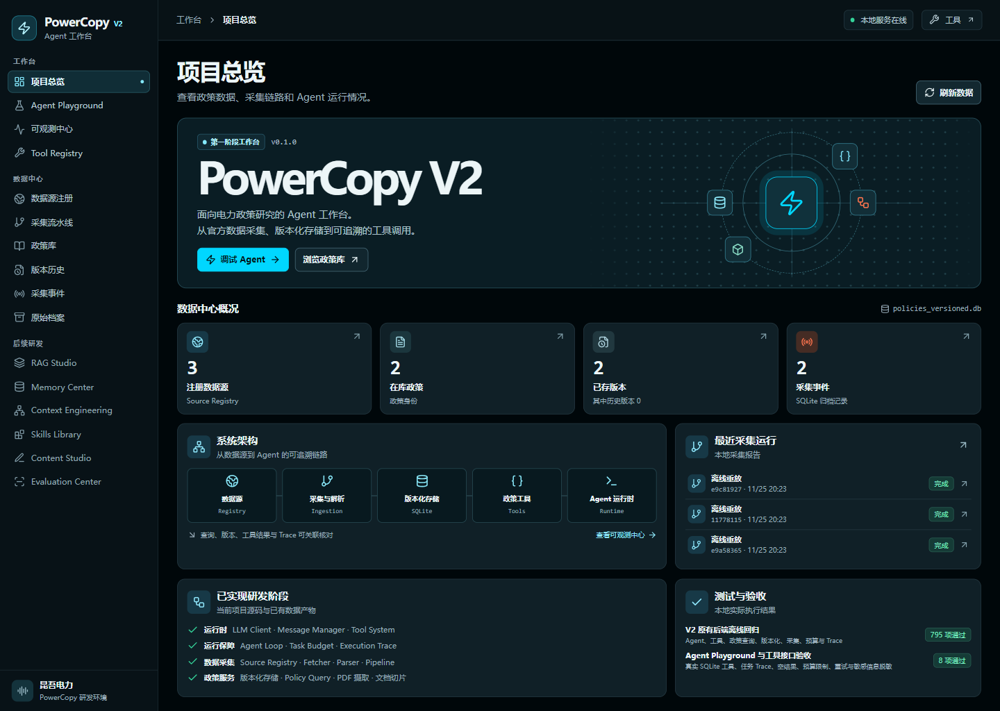
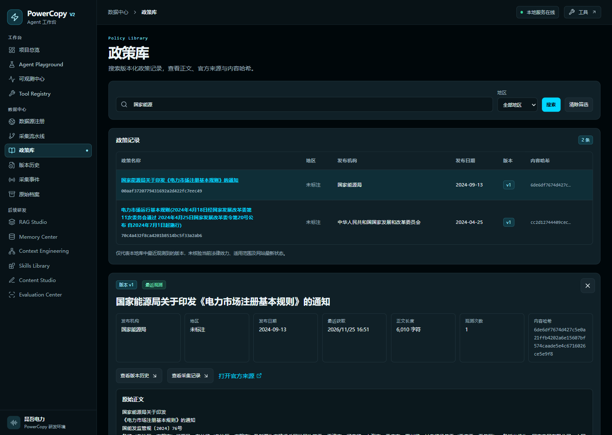
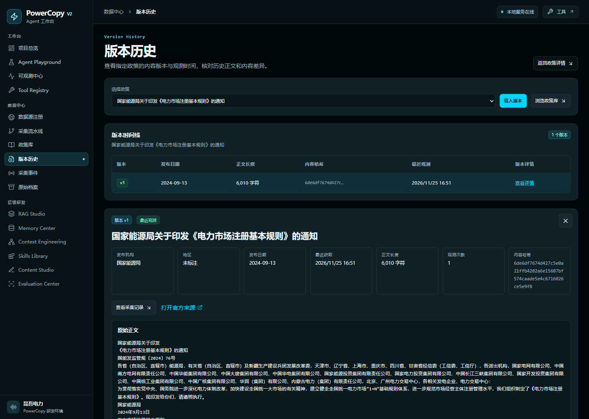
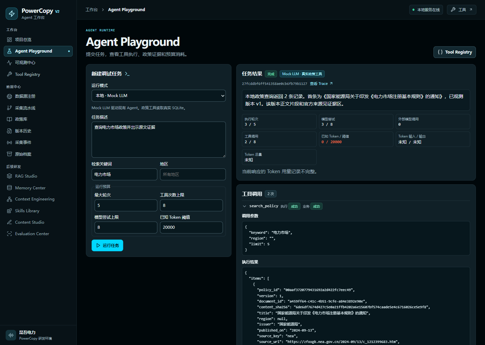
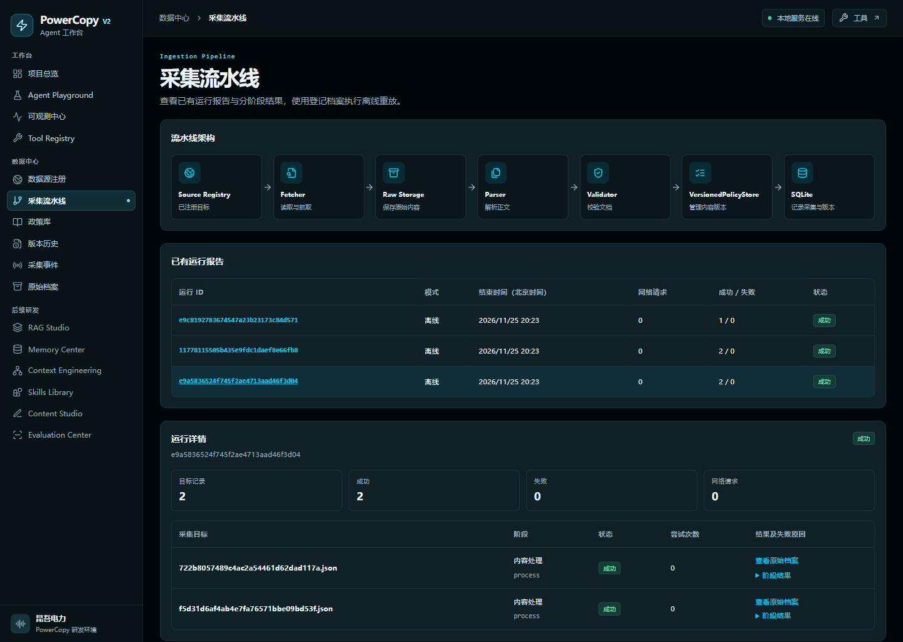
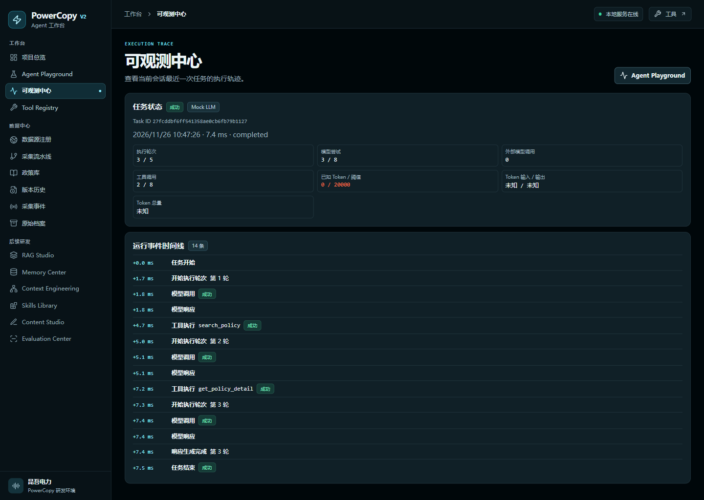

# PowerCopy V2

> 面向售电行业政策研究与文案生产的**可追溯 Agent 运行时**

PowerCopy V2 把「官方政策采集 → 解析清洗 → 版本化存储 → 切片索引 → Agent 检索生成」串成一条可审计的数据链路。每一个事实性输出都能回溯到原始网页字节、采集时间与内容哈希。

**当前状态：795 项自动化测试全部通过**

---

## 快速导航

| 页面 | 内容 |
|---|---|
| **[项目概览](Overview)** | 项目定位、能力清单、演进路线 |
| **[快速开始](Getting-Started)** | 环境搭建、启动、常见问题 |
| **[系统架构](Architecture)** | 分层设计、Agent 运行时、数据流 |
| **[数据中心详解](Data-Center)** | 采集到入库全链路 |
| **[工作台](Workbench)** | 10 个页面与 API 契约 |
| **[文档切片](Chunking)** | RAG 切片与可追溯性 |
| **[测试与验收](Testing)** | 795 项测试矩阵 |
| **[技术边界](Limitations)** | 明确未实现范围 |

---

## 界面预览

### 项目总览



### 政策库



### 版本历史



### Agent Playground



### 采集流水线



### 可观测中心



更多截图：[数据源注册](images/source-registry.png) · [Tool Registry](images/tool-registry.png) · [原始档案](images/raw-archive.png)

---

## 核心数字

| 指标 | 数值 |
|---|---|
| 自动化测试 | **795 项，全部通过** |
| 已验收阶段 | 阶段04（4.1–4.8）、阶段05（5.1） |
| 数据层模块 | 12 个 |
| 工作台页面 | 10 个，全部对接真实数据 |
| 真实政策样本 | 2 份（含完整哈希链路） |
| 第三方依赖 | 6 个 |

---

## 三条设计红线

### 1. 事实必须可追溯

每份入库政策绑定双重哈希：

- `raw_sha256` — 原始网页/PDF 字节哈希
- `content_sha256` — 标准化正文业务哈希

采集事件与文档版本分离，因此「采集 30 次、内容改 2 次」= **1 个身份 + 2 个版本 + 30 条观测**。

### 2. 不确定就拒绝（Fail Closed）

| 场景 | 处理 |
|---|---|
| CSS 选择器零匹配或多匹配 | 拒绝解析，不猜测 |
| 编码声明冲突 | 拒绝解码，不静默丢字节 |
| PDF 加密 / 无文本页 | 拒绝摄取 |
| 审核指纹不匹配 | 拒绝入库 |

### 3. 不编造业务结论

查询结果每次附带 `notice`：

- 未标注地区 **不等于** 全国适用
- 最新观测版本 **不等于** 当前法律有效
- 无结果 **不等于** 政策不存在

---

## 技术栈

| 层 | 技术 |
|---|---|
| 语言 | Python 3.12 |
| 数据校验 | Pydantic 2 |
| 存储 | SQLite（标准库） |
| HTTP | `urllib`（标准库） |
| HTML | BeautifulSoup 4 |
| PDF | pypdf 5.9 |
| API | FastAPI + uvicorn |
| 前端 | React 19 + Vite + TypeScript |
| 测试 | pytest |

**依赖克制**：采集用标准库而非 requests，存储用标准库而非 ORM。

---

## 快速验证

```powershell
python -m venv .venv
.\.venv\Scripts\Activate.ps1
pip install -e ".[dev]" -e ".[api]" -r requirements.txt

python -m pytest tests -q
# 期望：795 passed

uvicorn workbench.main:app --port 8000
```

---

## 真实数据

当前库中有两份**真实官方政策**：

| 政策 | 来源 | 发布 | 正文 |
|---|---|---|---|
| 电力市场运行基本规则 | 国家发改委 | 2024-04-25 | 3829 字 |
| 电力市场注册基本规则 | 国家能源局 | 2024-09-13 | 6010 字 |

完整链路：采集 → 原始字节存档 → 解析 → 版本化入库 → 切片。所有哈希可逐项核对。

---

## 仓库

- 代码：https://github.com/AJ-zj/power_copy
- 文档源码：`docs/` 目录

---

## 许可

内部项目，暂未开源授权。
