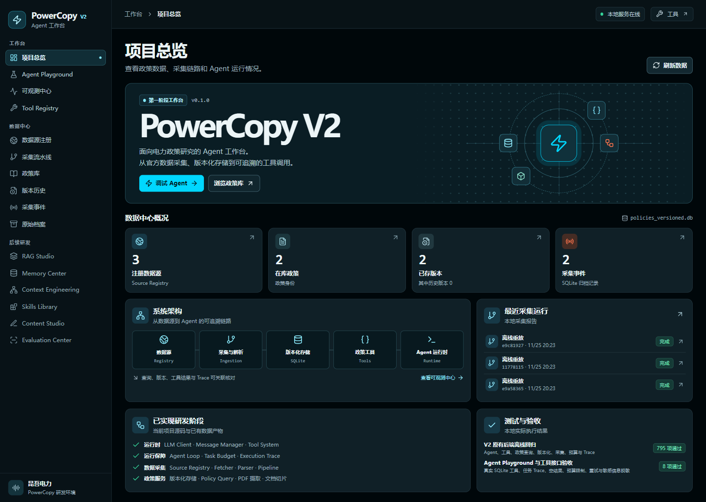

# Wiki 发布说明

这个目录存放 GitHub Wiki 的完整内容。

## 为什么放在主仓库

GitHub **不允许通过命令行创建 Wiki 仓库**——`.wiki.git` 只有在该仓库 Wiki 至少有一页内容后才存在。

因此本目录：
1. 作为 Wiki 内容的版本化备份
2. 可直接复制到 Wiki 仓库发布

## 发布步骤（一次性）

### 1. 先在网页上创建首页

访问 https://github.com/AJ-zj/power_copy/wiki

点 **Create the first page**，标题填 `Home`，内容随便写一行，点 **Save Page**。

这一步做完，`.wiki.git` 仓库就存在了。

### 2. 克隆 Wiki 仓库

```powershell
cd D:\桌面\昆吾电力项目
git clone https://github.com/AJ-zj/power_copy.wiki.git
```

### 3. 复制内容

```powershell
Copy-Item -Path .\PowerCopy-V2\wiki\* -Destination .\power_copy.wiki\ -Recurse -Force
```

### 4. 提交并推送

```powershell
cd .\power_copy.wiki
git add -A
git commit -m "docs: PowerCopy V2 Wiki 完整内容"
git push
```

### 5. 验证

访问 https://github.com/AJ-zj/power_copy/wiki 查看。

## 目录内容

| 文件 | 对应 Wiki 页面 |
|---|---|
| `Home.md` | 首页（导航 + 界面预览） |
| `Overview.md` | 项目概览 |
| `Getting-Started.md` | 快速开始 |
| `Architecture.md` | 系统架构 |
| `Data-Center.md` | 数据中心详解 |
| `Chunking.md` | 文档切片 |
| `Workbench.md` | 工作台 |
| `Testing.md` | 测试与验收 |
| `Limitations.md` | 技术边界 |
| `images/` | 9 张界面截图 |

## 链接说明

`Home.md` 里用的是 GitHub Wiki 的页面链接语法：

```markdown
[项目概览](Overview)
```

Wiki 会自动解析成 `/wiki/Overview`。**不要**改成 `.md` 后缀，那是普通 Markdown 的写法。

`docs/` 目录里的文档用的是相对路径（`overview.md`），那是给仓库内浏览用的。两套链接各自匹配各自的场景。

## 维护

更新内容时：

1. 先改 `docs/` 下的源文件
2. 同步复制到 `wiki/`
3. 重新推送到 Wiki 仓库

或者直接把 `wiki/` 当作权威源，改完再同步回 `docs/`。

## 截图

截图来自 `docs/screenshots/`，复制到 `wiki/images/`。

Wiki 页面里引用：

```markdown

```
